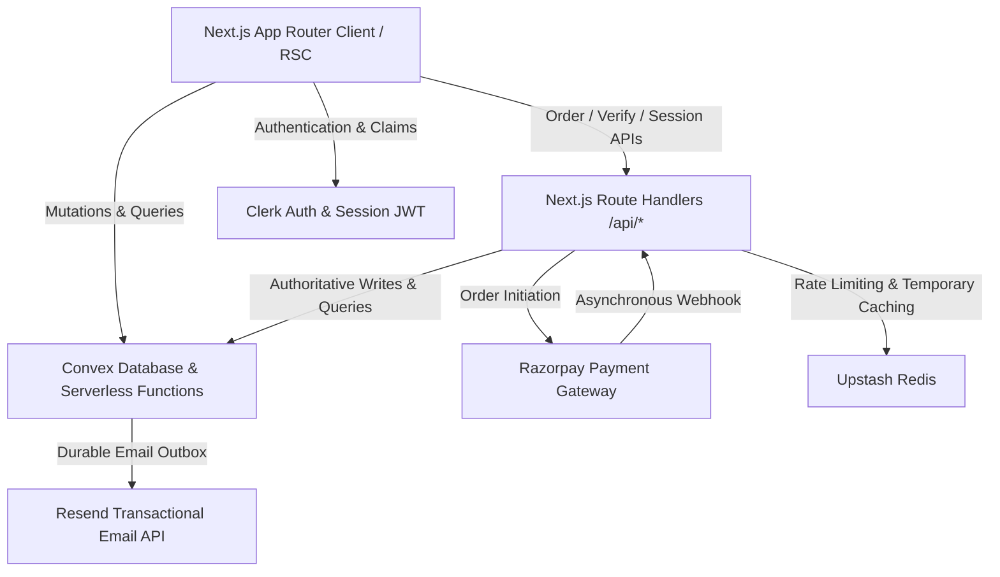
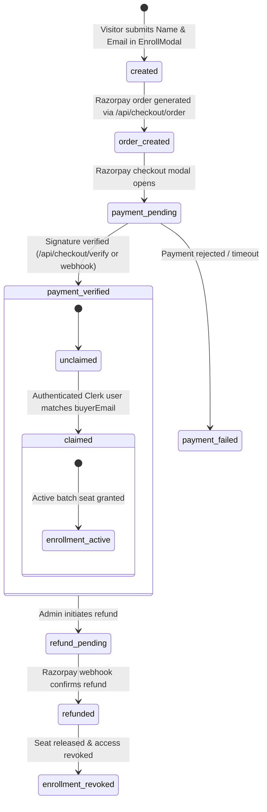

# VibeLogic Studio — System Execution Flow & Architecture

This document is the definitive source of truth for the internal execution flows, distributed boundaries, transaction models, and security protocols across VibeLogic Studio.

---

## 1. System Architecture & Authority Hierarchy

VibeLogic Studio operates on a strictly defined distributed authority model:

### Authority & Data Ownership Rules
1. **Convex is the single source of truth** for all persistent domain state: Purchases, Payments, Enrollments, Courses, Batches, Coupons, and Email Outbox jobs.
2. **Upstash Redis is cache-only**: Cache entries, session cookies, and rate limits never confer ownership or entitlement. Cache data may be evicted without data loss.
3. **Clerk is the identity provider**: Authentication occurs *after* payment in the payment-first checkout model. A Clerk user acquires entitlement only when a purchase's verified buyer email matches the user's verified Clerk email.
4. **Razorpay is the payment processor**: Razorpay callbacks and webhooks are cryptographically validated before any database transition occurs.

---

## 2. Purchase Lifecycle State Machine

The platform separates Payment Status, Purchase Claim Status, Enrollment Status, and Entitlement Status into orthogonal domains:

### State Isolation Principles
- **Payment Status (`payments.status`, `purchases.paymentStatus`)**: Indicates financial settlement (`pending` | `verified` | `failed` | `refunded`). A verified payment is permanent and is never altered if onboarding is abandoned.
- **Purchase Claim Status (`purchases.claimStatus`)**: Indicates whether an authenticated Clerk student has bound this purchase to their profile (`unclaimed` | `claimed`).
- **Enrollment Status (`enrollments.status`)**: Indicates active cohort participation (`active` | `dropped` | `completed`).
- **Entitlement Status**: Computed on the backend by querying active enrollments where `userId === authUser._id` and `batchId === targetBatchId`.

---

## 3. End-to-End Execution Flows

### 3.1 Pre-Checkout Buyer Details & Session Initiation

1. **Trigger**: Visitor clicks "Enroll Now" on `/` or `/build-software-with-ai`.
2. **Validation**: Client and server validate Name length (≥ 2 chars) and Email format. Prominently display accuracy warning.
3. **Execution**:
   - `convex/purchases.ts:createPurchaseSession` creates a durable `purchases` record:
     - `buyerName`, `buyerEmail` (normalized lowercase)
     - `courseId`, `batchId`
     - `amount` (canonical course price)
     - `paymentStatus: "pending"`, `claimStatus: "unclaimed"`
     - `sessionToken`: Cryptographically strong random 32-byte hex token
     - `recoveryTokenHash`: SHA-256 hash of a single-use 32-byte recovery token
     - `recoveryTokenExpiresAt`: Date.now() + 48 hours
   - Next.js route `/api/checkout/session` sets an HTTP-only, SameSite=Lax, Secure cookie `vls_purchase_session`.
4. **Response**: Redirects visitor to `/checkout?purchaseId={purchaseId}`.

### 3.2 Server-Authoritative Checkout & Coupon Application

1. **Trigger**: `/checkout?purchaseId={id}` loads in the browser.
2. **Validation**:
   - Server validates that `vls_purchase_session` cookie matches `purchase.sessionToken`.
   - Fetches canonical course and batch data directly from Convex.
3. **Coupon Evaluation (`convex/coupons.ts:validateCoupon`)**:
   - Checks code active state, expiration timestamp, usage count vs usage limit, and minimum purchase amount.
   - Calculates discount (Percentage or Fixed). Net payable amount is computed on the server.
   - Updates `purchases` record with `couponCode` and `discountAmount`.
4. **Order Initiation (`/api/checkout/order`)**:
   - Verifies batch capacity (`enrolledCount < capacity`).
   - Razorpay Order is created with amount in paise.
   - **Zero Secret Exposure**: Order notes contain *only* `{ purchaseId, courseId, batchId }`. Raw claim tokens and session tokens are strictly omitted from Razorpay notes and external logs.
   - Binds `razorpayOrderId` to the `purchases` record.

### 3.3 Cryptographic Dual-Channel Payment Verification

Both client verify (`/api/checkout/verify`) and webhook (`/api/webhooks/razorpay`) invoke the internal mutation `convex/payments.ts:fulfillPurchasePayment`:

1. **Signature Verification**:
   - Verify HMAC SHA-256 using `RAZORPAY_KEY_SECRET` or `RAZORPAY_WEBHOOK_SECRET`.
2. **Payload & Amount Reconciliation**:
   - Ensures `order_id` matches `purchases.razorpayOrderId`.
   - Verifies currency is `INR` and captured amount matches `purchases.amount`.
3. **Idempotency & Concurrency**:
   - If `purchases.paymentStatus === "verified"`, the mutation returns success immediately without side effects.
4. **Capacity-Aware Seat Allocation & Concurrency Guard**:
   - Atomic Convex transaction checks `batch.enrolledCount >= batch.capacity`:
     - If seat available: marks `purchases.paymentStatus = "verified"`, `entitlementStatus = "pending_claim"`, increments `batches.enrolledCount`, and records `payments` entry.
     - If cohort reached capacity during checkout: verified payment is permanently preserved (`paymentStatus = "verified"`), `batches.enrolledCount` is capped at capacity, and purchase is marked `entitlementStatus = "pending_reconciliation"` with audit logging for administrative transfer or waitlist.
5. **Idempotent Redis Cache Invalidation**:
   - Both `/api/checkout/verify` and `/api/webhooks/razorpay` call `invalidatePurchaseRelatedCaches`:
     - Evicts `courses:detail:{slug}`, `course:v1:{slug}`, `marketplace:v1:*`, and `courses:market:*`.
     - Evicts student dashboard keys if `clerkId` is known.
     - Safe and non-blocking: cache eviction warnings never fail monetary transactions.
6. **Email Outbox Job Creation**:
   - Activates draft record in `emailJobs` to `status: "pending"`.

### 3.4 Protected 3-Step Post-Payment Onboarding (`/checkout/onboarding`)

1. **Access Guard & Server Actions**:
   - Next.js Server Component authoritatively reads `vls_purchase_session` cookie via `getPurchaseSessionFromCookies()`.
   - Client components interact strictly via Next.js Server Actions (`updateBuyerDetailsAction`, `updateOnboardingProgressAction`, `dispatchWelcomeEmailAction`).
   - Zero client-side `document.cookie` reading; session tokens are never exposed in HTML, client props, or URLs.
   - If `paymentStatus !== "verified"` or session is invalid, access is denied (redirects to `/`).
2. **Step 1 — Confirm Buyer Details**:
   - Displays stored Name & Email.
   - Buyer can correct typos in Name or Email via `updateBuyerDetailsAction`.
   - Updating email mutates `purchases.buyerEmail` and updates the pending `emailJobs` recipient address.
3. **Step 2 — WhatsApp Community Invitation**:
   - Displays batch-specific invite link (`batch.whatsappLink`).
   - Non-blocking: clicking "Join WhatsApp" opens the invite in a new tab; student can skip without penalty.
4. **Step 3 — Completion & Dispatch**:
   - Confirms payment is verified.
   - Invokes `dispatchWelcomeEmailAction(purchaseId)` server action.

### 3.5 Outbox Email Delivery & Account Claiming (`/claim`)

1. **Authenticated Email Dispatch Endpoint (`/api/checkout/email-dispatch`)**:
   - Protected by `CRON_SECRET` using timing-safe comparison (`crypto.timingSafeEqual`).
   - Supports targeted dispatch with `{ purchaseId }` or bounded batch processing (up to 10 jobs per trigger) for production schedulers.
   - Atomic Convex transaction transitions jobs `pending` -> `processing` -> `sent` / `failed`.
2. **Account Linking (`convex/purchases.ts:claimPurchase`)**:
   - Student navigates to `/claim` and authenticates via Clerk.
   - Mutation requires `ctx.auth.getUserIdentity()`.
   - **Ownership Rule**: The backend strictly verifies:
     `identity.email.toLowerCase() === purchase.buyerEmail.toLowerCase()`
   - **Oversubscription Check**: If `purchase.entitlementStatus === "pending_reconciliation"`, automatic claiming is blocked until an admin resolves or reassigns the cohort.
   - If recovery token is provided, verify `SHA256(recovery) === purchase.recoveryTokenHash` and `Date.now() < recoveryTokenExpiresAt`.
   - Sets `purchases.claimStatus = "claimed"`, `purchases.claimedByUserId = user._id`, and `entitlementStatus = "active"`.
   - Invalidates `recoveryTokenHash` immediately upon claiming (single-use redemption).
   - Creates or updates `enrollments` record (`userId: user._id, batchId, status: "active"`).
   - Redirects student directly to `/dashboard/courses/{batchId}/overview`.

---

## 4. Security & Account Sharing Protections

1. **Access Path Protection**:
   - Every LMS query (`convex/student.ts`) invokes `requireStudentEnrolledInBatch(ctx, batchId)`.
   - Guessing purchase IDs, modifying cookies, or forwarding URLs cannot unlock course materials without an active `enrollments` record for the authenticated Clerk identity.
2. **Moderate Account-Sharing Detection**:
   - Track active sessions in `users.security`: hashes of client IP and user agent with timestamps.
   - If concurrent active sessions from > 3 distant distinct IP subnets are observed within a 15-minute window, log an audit event in `activities` and flag the profile for admin review without interrupting legitimate mobile/desktop switches.