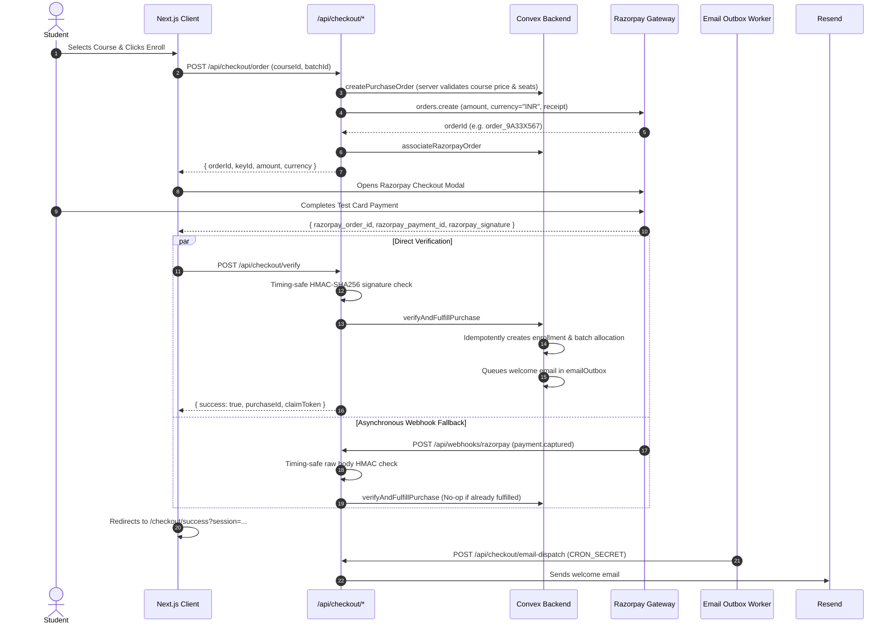

# VibeLogic Studio — Razorpay Payment Integration & Environment Setup Guide

This guide provides exhaustive, production-grade instructions for configuring, testing, and operating Razorpay payments, Clerk authentication, Convex database functions, Resend transactional emails, and Upstash Redis caching in **VibeLogic Studio**.

---

## 1. Environment Variable Reference

The table below lists all configuration variables discovered and utilized across the application. 

> **Important**: Never check secret keys into Git. `.env.local` is strictly ignored by `.gitignore`.

| Environment Variable | Service | Scope | Required / Optional | Description & Where Consumed |
| :--- | :--- | :--- | :--- | :--- |
| `NEXT_PUBLIC_RAZORPAY_KEY_ID` | Razorpay | Public (Client) | **Required** | Razorpay Key ID used to initialize the client checkout modal (`CheckoutModal.tsx`, `RazorpayCheckoutModal.tsx`). |
| `RAZORPAY_KEY_SECRET` | Razorpay | Server-Only | **Required** | Razorpay Key Secret used server-side to generate HMAC-SHA256 signatures and create orders (`app/api/checkout/order/route.ts`, `app/api/checkout/verify/route.ts`, `convex/payments.ts`). |
| `RAZORPAY_WEBHOOK_SECRET` | Razorpay | Server-Only | **Required** | Webhook secret configured in Razorpay Dashboard to sign webhook payloads (`app/api/webhooks/razorpay/route.ts`). |
| `NEXT_PUBLIC_CONVEX_URL` | Convex | Public (Client) | **Required** | Convex deployment URL for client-side queries and mutations (`ConvexClientProvider.tsx`). |
| `CONVEX_DEPLOYMENT` | Convex | Server/CLI | **Required** | Convex project target deployment identifier used by Convex CLI. |
| `NEXT_PUBLIC_CONVEX_SITE_URL` | Convex | Public/Server | Optional | Convex HTTP Actions endpoint base URL. |
| `NEXT_PUBLIC_CLERK_PUBLISHABLE_KEY`| Clerk | Public (Client) | **Required** | Clerk public key for auth middleware and user sessions (`middleware.ts`). |
| `CLERK_SECRET_KEY` | Clerk | Server-Only | **Required** | Clerk backend API communication and claims verification (`middleware.ts`, `app/api/checkout/claim/route.ts`). |
| `CLERK_WEBHOOK_SECRET` | Clerk | Server-Only | Optional | Secret for verifying Clerk user event webhooks (`app/api/webhooks/clerk/route.ts`). |
| `CLERK_JWT_ISSUER_DOMAIN` | Clerk/Convex | Server-Only | Optional | Domain used by `convex/auth.config.ts` to validate Clerk JWTs. Defaults to Clerk frontend API domain if omitted. |
| `RESEND_API_KEY` (or `RESEND`) | Resend | Server-Only | Optional / Recommended | API key used by `lib/resend.ts` to dispatch welcome/recovery emails. |
| `RESEND_FROM_EMAIL` | Resend | Server-Only | Optional | Verified sender email address (defaults to `onboarding@resend.dev` if omitted). |
| `CRON_SECRET` | System / Cron | Server-Only | **Required for Background Jobs** | Authorization secret for the protected `/api/checkout/email-dispatch` outbox processor. |
| `UPSTASH_REDIS_REST_URL` | Upstash Redis | Server-Only | Optional | REST endpoint URL for Upstash Redis cache invalidation (`lib/redis.ts`). |
| `UPSTASH_REDIS_REST_TOKEN` | Upstash Redis | Server-Only | Optional | REST authentication token for Upstash Redis (`lib/redis.ts`). |
| `NEXT_PUBLIC_APP_URL` | Next.js App | Public (Client) | Optional | Canonical web application URL (defaults to `http://localhost:3000`). |
| `NEXT_PUBLIC_POSTHOG_KEY` | PostHog | Public (Client) | Optional | Analytics telemetry public key. |
| `NEXT_PUBLIC_POSTHOG_HOST` | PostHog | Public (Client) | Optional | PostHog API host (e.g. `https://us.i.posthog.com`). |
| `UPLOADTHING_SECRET` | UploadThing | Server-Only | Optional | File storage upload secret for media manager. |
| `UPLOADTHING_APP_ID` | UploadThing | Server-Only | Optional | File storage application ID for media manager. |

---

## 2. Where to Obtain Credentials

### 2.1 Razorpay
1. Sign in to the [Razorpay Dashboard](https://dashboard.razorpay.com/).
2. Toggle the dashboard to **Test Mode** (switch in top navigation bar).
3. Navigate to **Account & Settings** → **API Keys**.
4. Click **Generate Key**.
   - Copy the **Key ID** (`rzp_test_...`) → `NEXT_PUBLIC_RAZORPAY_KEY_ID`.
   - Copy the **Key Secret** → `RAZORPAY_KEY_SECRET`.
5. Navigate to **Account & Settings** → **Webhooks**.
6. Click **Add New Webhook** (see section 5 for exact details).
   - Enter your webhook secret → `RAZORPAY_WEBHOOK_SECRET`.

### 2.2 Clerk Authentication
1. Sign in to the [Clerk Dashboard](https://dashboard.clerk.com/).
2. Select your application.
3. Under **Configure** → **API Keys**:
   - Copy **Publishable key** (`pk_test_...`) → `NEXT_PUBLIC_CLERK_PUBLISHABLE_KEY`.
   - Copy **Secret key** (`sk_test_...`) → `CLERK_SECRET_KEY`.
4. Under **Configure** → **JWT Templates**:
   - Verify a Convex JWT template exists if custom claims are needed.
5. Under **Configure** → **Webhooks** (Optional):
   - Set up an endpoint for `user.created` / `user.updated` → `CLERK_WEBHOOK_SECRET`.

### 2.3 Convex
1. Sign in to the [Convex Dashboard](https://dashboard.convex.dev/).
2. Select your project.
3. Under **Settings** → **URL & Deploy Key**:
   - Copy **Deployment URL** → `NEXT_PUBLIC_CONVEX_URL`.
   - Copy **Deployment Name** → `CONVEX_DEPLOYMENT`.

### 2.4 Resend
1. Sign in to the [Resend Dashboard](https://resend.com/).
2. Navigate to **API Keys** → **Create API Key**.
   - Copy the key (`re_...`) → `RESEND_API_KEY`.
3. Navigate to **Domains**:
   - For local test mode: Use `onboarding@resend.dev` (only sends to your registered Resend email address).
   - For production: Add and verify your custom sending domain (e.g., `updates@vibelogic.studio`) and set `RESEND_FROM_EMAIL`.

### 2.5 Upstash Redis
1. Sign in to the [Upstash Console](https://console.upstash.com/).
2. Create or select a Redis database.
3. Under **REST API** section:
   - Copy `UPSTASH_REDIS_REST_URL`.
   - Copy `UPSTASH_REDIS_REST_TOKEN`.

### 2.6 Cron Secret
Generate a cryptographically secure 32+ character random hex string:
```bash
node -e "console.log(require('crypto').randomBytes(32).toString('hex'))"
```
Set this value as `CRON_SECRET` in both your local environment and your production deployment.

---

## 3. Local Development Configuration

1. Create `.env.local` by copying `.env.example`:
   ```bash
   cp .env.example .env.local
   ```
2. Populate the keys with your **Test Mode** credentials:
   ```env
   # Convex
   CONVEX_DEPLOYMENT=dev:your-convex-deployment
   NEXT_PUBLIC_CONVEX_URL=https://your-deployment.convex.cloud

   # Clerk
   NEXT_PUBLIC_CLERK_PUBLISHABLE_KEY=pk_test_...
   CLERK_SECRET_KEY=sk_test_...

   # Razorpay (Test Mode)
   NEXT_PUBLIC_RAZORPAY_KEY_ID=rzp_test_...
   RAZORPAY_KEY_SECRET=your_test_key_secret
   RAZORPAY_WEBHOOK_SECRET=your_test_webhook_secret

   # Resend
   RESEND_API_KEY=re_...
   RESEND_FROM_EMAIL=onboarding@resend.dev

   # Cron Secret
   CRON_SECRET=your_secure_cron_token_min_32_chars

   # Upstash Redis
   UPSTASH_REDIS_REST_URL=https://...upstash.io
   UPSTASH_REDIS_REST_TOKEN=...
   ```
3. Run the development environment:
   ```bash
   npx convex dev
   npm run dev
   ```

---

## 4. Convex Environment Variables Configuration

Convex functions execute in an isolated serverless runtime. Any environment variables needed inside `convex/` functions (such as `RAZORPAY_KEY_SECRET` or `CLERK_JWT_ISSUER_DOMAIN`) must be set directly in Convex.

### Option A: Via Convex CLI
```bash
npx convex env set RAZORPAY_KEY_SECRET "your_test_key_secret"
npx convex env set CLERK_JWT_ISSUER_DOMAIN "https://your-clerk-domain.clerk.accounts.dev"
```

### Option B: Via Convex Dashboard
1. Go to [Convex Dashboard](https://dashboard.convex.dev/).
2. Choose your deployment → **Settings** → **Environment Variables**.
3. Add the variable name and value, then click **Save**.

---

## 5. Razorpay Webhook Configuration

The webhook receiver guarantees that even if a student closes their browser immediately upon paying, their purchase, enrollment, and onboarding record are fulfilled idempotently.

### 5.1 Endpoint URL
- **Local Testing**: Use an HTTPS tunnel such as ngrok or Localtunnel:
  ```bash
  ngrok http 3000
  ```
  Webhook URL: `https://<your-ngrok-subdomain>.ngrok-free.app/api/webhooks/razorpay`
- **Production**:
  Webhook URL: `https://vibelogic.studio/api/webhooks/razorpay`

### 5.2 Supported & Handled Webhook Events
In the Razorpay Dashboard under **Account & Settings** → **Webhooks** → **Add New Webhook**, select these exact events:

1. `payment.captured` — Triggered when a payment is successfully captured. Fulfils purchase, allocates batch seats, and triggers outbox email.
2. `order.paid` — Triggered when a full order amount has been satisfied. Ensures fallback fulfillment if order-level events arrive first.
3. `payment.failed` — Triggered when a transaction declines or fails. Idempotently marks purchase as `failed` without overturning already fulfilled purchases.

### 5.3 Webhook Secret
Set the secret in the Razorpay Webhook form to match your `RAZORPAY_WEBHOOK_SECRET` in `.env.local` and Vercel/Convex.

---

## 6. How the Payment Flow Works (Security & Idempotency)



---

## 7. Testing Procedures

### 7.1 Successful Payment Test (Razorpay Test Mode)
1. Navigate to `/courses`.
2. Select any active course and click **Enroll Now**.
3. In the Razorpay Checkout Modal, enter:
   - **Phone**: `9876543210`
   - **Payment Method**: Card
   - **Card Number**: Use standard Razorpay test card: `4012 0000 0000 0002` (or any valid test card)
   - **Expiry**: `12/30`
   - **CVV**: `123`
4. Click **Pay**. In the test OTP dialog, click **Success**.
5. Observe:
   - Client redirects to `/checkout/success`.
   - Onboarding session cookie is set (`vls_onboarding_token`).
   - Student dashboard displays access to the enrolled course.

### 7.2 Failed or Cancelled Payment Test
1. Initiate checkout as above.
2. In the Razorpay modal, select Card, and click **Failure** or close the popup.
3. Observe:
   - Checkout modal displays clear cancellation feedback.
   - Convex `recordFailedPayment` mutation flags the purchase as failed.
   - No course access or enrollments are granted.

### 7.3 Duplicate Payment & Race Condition Test
- When both direct checkout verification and `payment.captured` webhook fire simultaneously:
  - Convex transactional mutations evaluate `purchase.status === "completed"`.
  - The second transaction detects existing completion, returning the existing purchase record without duplicating enrollments or batch allocations.

### 7.4 Batch Capacity Exhaustion Test
- If batch seats reach capacity (`currentEnrollments >= maxCapacity`):
  - The payment remains securely recorded as `verified`.
  - The purchase status enters `pending_reconciliation`.
  - Admin receives a review flag without student funds being lost.

---

## 8. Transactional Emails & Outbox Dispatch

1. When a purchase completes, a job is inserted into the Convex `emailOutbox` collection with status `"pending"`.
2. Dispatch is triggered via a POST request to `/api/checkout/email-dispatch` with the header:
   ```http
   Authorization: Bearer <CRON_SECRET>
   ```
3. To configure automated periodic dispatch:
   - **Vercel Cron**: Configured in `vercel.json` to call `/api/checkout/email-dispatch` every 1-5 minutes with `CRON_SECRET`.
   - **External Cron**: Set up a cron monitor (e.g., cron-job.org) hitting `https://vibelogic.studio/api/checkout/email-dispatch` with the Authorization header.
4. **Fault Tolerance Guarantee**:
   - Resend failures increment `attempts` up to 5 times.
   - Email failure **never** reverses a verified payment or revokes course enrollment.

---

## 9. Preparing for Production Checklist

Before switching from Razorpay Test Mode to Live Mode:

1. [ ] **Razorpay Account KYC**: Ensure your Razorpay account activation and business KYC are approved.
2. [ ] **Live Keys**:
   - In Razorpay Dashboard, toggle to **Live Mode**.
   - Generate Live API keys (`rzp_live_...`).
   - Add `NEXT_PUBLIC_RAZORPAY_KEY_ID` and `RAZORPAY_KEY_SECRET` to production environment variables (e.g., Vercel / Convex).
3. [ ] **Live Webhooks**:
   - Register `https://vibelogic.studio/api/webhooks/razorpay` in Razorpay Live Dashboard.
   - Configure events: `payment.captured`, `order.paid`, `payment.failed`.
   - Set secret as `RAZORPAY_WEBHOOK_SECRET` in production variables.
4. [ ] **Resend Sending Domain**:
   - Verify your custom domain in Resend DNS (DKIM, SPF, DMARC).
   - Set `RESEND_FROM_EMAIL=admissions@vibelogic.studio`.
5. [ ] **Clerk Production Instance**:
   - Switch from Clerk Development to Production instance.
   - Add production publishable & secret keys.
6. [ ] **Never Commit `.env.local`**:
   - Confirm `.gitignore` excludes all `.env*` except `.env.example`.

---

## 10. Troubleshooting Common Issues

| Issue / Symptom | Root Cause | Solution |
| :--- | :--- | :--- |
| `Razorpay key ID is not configured` | Missing `NEXT_PUBLIC_RAZORPAY_KEY_ID` in `.env.local` | Ensure variable is defined with prefix `NEXT_PUBLIC_` and restart `npm run dev`. |
| `ERR_CRYPTO_TIMING_SAFE_EQUAL_LENGTH` | Signature length mismatch between client signature and computed HMAC | Verify `RAZORPAY_KEY_SECRET` matches the key ID pair generated in Razorpay Dashboard. |
| `Invalid webhook signature` | Webhook body parsed as JSON instead of raw text buffer before HMAC check | Ensure `req.text()` is passed directly to `crypto.createHmac` without modification. |
| `Email outbox dispatch returns 401` | Missing or incorrect `CRON_SECRET` in request header | Pass `Authorization: Bearer <CRON_SECRET>` matching the server configuration. |
| Convex mutation fails: `Unauthenticated` | Clerk token expired or Convex auth template unconfigured | Verify Clerk Convex JWT template exists and Clerk session is active. |
| Redis timeout warning in logs | Upstash Redis unreachable or credentials empty | Caching gracefully degrades; check `UPSTASH_REDIS_REST_URL` and `UPSTASH_REDIS_REST_TOKEN`. |
